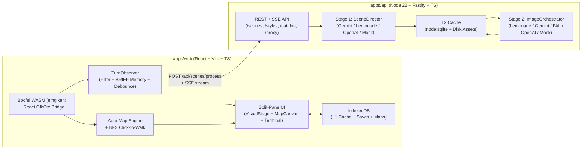

# Zorkaliser

**Zorkaliser** is a browser-based Z-machine interactive fiction (IF) player for classic Infocom and Inform text adventures (`.z1`–`.z8` and `.zblorb`) with **real-time AI scene illustrations** and **interactive auto-mapping**.

Games run 100% client-side in WebAssembly via **Bocfel** (`emglken`), while a lightweight Node.js/TypeScript backend turns room descriptions into cohesive artwork in your chosen art style—using **Google Gemini**, a **local GPU via Lemonade Server**, **OpenAI**, **FAL.ai Flux**, or a built-in keyless preview mode.

---

## Features

### Phase 1 — Real-Time AI-Illustrated Z-Machine Player
- **Full Z-Machine Emulation (V1–V8):** Runs Infocom classics and modern Inform Z-code stories directly in the browser via `Bocfel` WASM and a custom React GlkOte bridge (clean status bar separation, styled prose, single-key `char` and `line` input, command history, and collapsible quick-compass controls).
- **7 Art Style Presets + Custom Style:** Choose your visual aesthetic at game launch or switch mid-game:
  - *80s Fantasy Oil*, *Photoreal Cinema*, *Graphic Novel*, *Cyberpunk Noir*, *16-Bit Pixel Art*, *Storybook Watercolor*, *Gothic Engraving*, or any *Custom Style* prompt.
- **Two-Stage Scene Pipeline:**
  - **Stage 1 (Scene Director):** Extracts canonical room details, preserves classic `BRIEF`-mode descriptions across revisits, detects pitch-black darkness, and crafts wide eye-level environmental establishing shots (no UI overlays or foreground hands).
  - **Stage 2 (Multi-Provider Image Orchestrator):** Streams progress over Server-Sent Events (SSE) with smooth crossfades so gameplay is never blocked while artwork paints.
- **Smart Once-Per-Location Caching:** Defaults to rendering once per location (`location_only`) with two-tier caching (browser IndexedDB L1 + backend `node:sqlite` & disk L2), so taking/examining items stays visually rock-solid and revisiting rooms is instant. Includes **Regenerate** with variation switching (`1/2`) and a **Session Gallery**.
- **Portable Quetzal Saves & Reader Themes:** Browser IndexedDB save slots + standard Quetzal `.sav` upload/download, and 4 terminal themes (*Midnight Dark*, *Parchment Light*, *Warm Sepia*, *Retro Green CRT*) with adjustable serif/sans/mono typography.

### Phase 2 — Interactive Auto-Mapping
- **Spoiler-Free Live Mapping:** Tracks directional commands (`n`, `go ne`, `climb up`, `enter house`, `leave`) on every turn—even during rapid speed-walking—placing rooms at collision-free compass offsets and upgrading return paths to bidirectional links.
- **Multi-Floor Elevation & Exit Stubs:** Separates `UP`/`DOWN` transitions into switchable floor layers with translucent ghosting of adjacent floors, marks locked/blocked passages, and draws dashed unexplored exit stubs from room prose and Stage 1 hints.
- **Visual Integration & Room Tools:** Room cards display your Phase 1 AI artwork thumbnails. Click any room to view its description, edit personal **Room Notes**, set custom color markers, drag rooms to tidy layouts, or use **Split Maze** for identical-name mazes.
- **Safe Click-to-Walk:** Double-click any visited room (or click **Walk Here**) to traverse the shortest known open BFS path one turn at a time, halting immediately if interrupted by a locked door, darkness, combat, or unexpected event.
- **Flexible Layout & Exports:** Toggle **Art | Art + Map | Map** in the left pane, export maps as **SVG**, **PNG**, or **JSON** (plus JSON import), and keep maps automatically synced with IndexedDB and Quetzal browser save slots.

---

## Architecture



### Repository Structure
```text
zorkaliser/
├── SPEC.md                 # Full Phase 1 & Phase 2 software specification
├── .env.example            # Backend provider & safeguard configuration template
├── packages/
│   └── shared/             # Shared Zod schemas, Style Bibles, catalog, map types
└── apps/
    ├── api/                # Fastify API, Scene Director, image adapters, SQLite L2 cache, IF proxy
    └── web/                # React + Vite frontend, Bocfel WASM runner, VisualStage, MapCanvas
```

---

## Quick Start

### Prerequisites
- **Node.js 22+** (uses Node 22's built-in `node:sqlite` with zero native C++ addon compilation).

### 1. Install Dependencies
```bash
npm install
```
*(On Windows PowerShell if script execution policy blocks `npm.ps1`, use `npm.cmd` instead of `npm`.)*

### 2. Configure `.env`
Copy `.env.example` to `.env` in the repository root:
```bash
cp .env.example .env
```
With no keys configured, Zorkaliser starts immediately in **keyless SVG Preview Mode** so you can test the Z-machine interpreter, caching, SSE progress, and Auto-Map right away. See **AI Provider Setup** below to connect a live cloud or local model.

### 3. Run Development Servers
```bash
npm run dev
```
This starts:
- **Backend API:** `http://127.0.0.1:3001`
- **Frontend Web App:** `http://localhost:5173` (proxies `/api` to `:3001`)

Open **http://localhost:5173** in your browser, pick an art style, and launch one of the free classics or drag-and-drop your own `.z1`–`.z8` / `.zblorb` story file.

---

## AI Provider Setup

### Option A: Local GPU via Lemonade Server (Zero Image Cost)
[Lemonade Server](https://lemonade-server.ai/) natively runs `stable-diffusion.cpp` (`sd-cpp`) models via an OpenAI-compatible `/v1/images/generations` endpoint (default port `13305`) alongside local LLMs (`/v1/chat/completions`).

1. Pull a fast image model on your Lemonade Server machine (for a 24 GB GPU, `Flux-2-Klein-4B`, `Z-Image-Turbo`, or `SDXL-Turbo` are great choices):
   ```bash
   lemonade pull Flux-2-Klein-4B
   ```
   *(If Lemonade runs on another machine on your LAN, start it with `--host 0.0.0.0 --port 13305` and allow TCP `13305` through your firewall.)*
2. **Windows AMD RDNA3 (e.g., RX 7900 XTX) Tip:** If `sd-cpp:rocm` resets under Windows, install and select the Vulkan backend:
   ```bash
   lemonade backends install sd-cpp:vulkan
   lemonade config set sdcpp.backend=vulkan
   ```
3. Configure `.env` (hybrid Gemini Stage 1 + local Lemonade Stage 2, or 100% local by setting `LLM_PROVIDER=lemonade` + `LEMONADE_LLM_MODEL`):
   ```dotenv
   LLM_PROVIDER=gemini
   IMAGE_PROVIDER=lemonade

   GEMINI_API_KEY=your_gemini_api_key_here
   GEMINI_LLM_MODEL=gemini-3.8-flash

   LEMONADE_BASE_URL=http://localhost:13305/v1
   LEMONADE_IMAGE_MODEL=Flux-2-Klein-4B
   LEMONADE_IMAGE_STEPS=4
   LEMONADE_IMAGE_CFG_SCALE=1
   ```

### Option B: Google Gemini (Cloud Stage 1 & Stage 2)
```dotenv
LLM_PROVIDER=gemini
IMAGE_PROVIDER=gemini
GEMINI_API_KEY=your_gemini_api_key_here
GEMINI_LLM_MODEL=gemini-3.8-flash
GEMINI_IMAGE_MODEL=gemini-3.1-flash-image
GEMINI_IMAGE_FALLBACK_MODEL=gemini-3.1-flash-lite-image
GEMINI_IMAGE_HIGH_MODEL=gemini-3-pro-image
```
> **Note:** Google AI Studio requires billing enabled on your project for Gemini image generation models (otherwise image endpoints return HTTP 429). You can pair `LLM_PROVIDER=gemini` with `IMAGE_PROVIDER=lemonade` or `IMAGE_PROVIDER=mock` without image billing.

### Option C: OpenAI / FAL.ai Flux
Set `OPENAI_API_KEY` (`LLM_PROVIDER=openai`, `IMAGE_PROVIDER=openai`) or `FAL_KEY` (`IMAGE_PROVIDER=fal`). See [.env.example](.env.example) for all available options:

| Variable | Default | Description |
| :--- | :--- | :--- |
| `LLM_PROVIDER` | `auto` | Stage 1 Scene Director (`auto`, `gemini`, `openai`, `lemonade`, `mock`) |
| `IMAGE_PROVIDER` | `auto` | Stage 2 Image Generator (`auto`, `gemini`, `imagen`, `fal`, `openai`, `lemonade`, `mock`) |
| `GEMINI_API_KEY` | — | Google AI Studio API key |
| `GEMINI_LLM_MODEL` | `gemini-3.8-flash` | Gemini Stage 1 JSON model |
| `GEMINI_IMAGE_MODEL` | `gemini-3.1-flash-image` | Primary Gemini image model |
| `LEMONADE_BASE_URL` | `http://localhost:13305/v1` | Lemonade Server OpenAI-compatible base URL |
| `LEMONADE_LLM_MODEL` | — | Optional local LLM ID when `LLM_PROVIDER=lemonade` |
| `LEMONADE_IMAGE_MODEL` | `SDXL-Turbo` | Lemonade `sd-cpp` image model ID (e.g. `Flux-2-Klein-4B`) |
| `LEMONADE_IMAGE_STEPS` | *(recipe default)* | Optional diffusion step override (e.g. `4` for Flux-2-Klein / SDXL-Turbo) |
| `LEMONADE_IMAGE_CFG_SCALE` | *(recipe default)* | Optional CFG scale override (e.g. `1` for Flux-2-Klein) |
| `LEMONADE_TIMEOUT_MS` | `120000` | Timeout in ms for local cold model loading + generation |
| `DAILY_COST_CAP_USD` | `10.00` | Daily cloud spend circuit breaker (bypassed for `$0` local/mock providers) |
| `DATA_DIR` | `./data` | Directory for SQLite cache DB and cached artwork files |

---

## Loading Games & Copyright

- **Curated Free Classics:** Includes 1-click links to freely redistributable Z-code titles on the IF Archive (*9:05*, *Colossal Cave Adventure*, *Lost Pig*, *Photopia*, *Curses*) fetched via an SSRF-hardened backend proxy (`POST /api/proxy/story`).
- **Your Own Infocom Story Files:** Drag and drop your own `.z1`–`.z8`, `.dat`, or `.zblorb` files directly into the launcher. Story binaries execute 100% client-side in WebAssembly and are **never uploaded to or hosted on the server**—only a SHA-256 story fingerprint is sent for scene caching.

---

## Development & Testing

```bash
# Typecheck all 3 workspaces (shared, api, web)
npm run typecheck

# Production build (compiles shared + api + Vite web bundle including bocfel.wasm)
npm run build

# Run all 32 unit & integration tests across api and web
npm run test
```

### Test Suites
- `apps/api`: `sceneDirector.test.ts`, `imageProviders.test.ts` (Gemini, quota error preservation, Lemonade adapter), `store.test.ts` (SQLite L2 cache & variations), `api.test.ts` (SSE flow, caching, regeneration, SSRF proxy protection).
- `apps/web`: `storyFingerprint.test.ts` (Z-code & Blorb headers), `turnObserver.test.ts` (same-room skip, darkness reveal, debounce, `BRIEF` memory), `mapEngine.test.ts` (compass placement, collision resolution, elevation, locked doors, maze split), `mapPathfinder.test.ts` (BFS safe Click-to-Walk).

---

## Credits & Documentation

- Full design specification: [SPEC.md](SPEC.md)
- Z-machine WebAssembly emulation powered by [Bocfel](https://github.com/garglk/garglk) via [Emglken](https://github.com/curiousdannii/emglken) (part of the [Parchment](https://github.com/curiousdannii/parchment) / GlkOte interactive fiction ecosystem).
- Local GPU inference tested with [Lemonade Server](https://lemonade-server.ai/) (`sd-cpp` / `stable-diffusion.cpp`).
