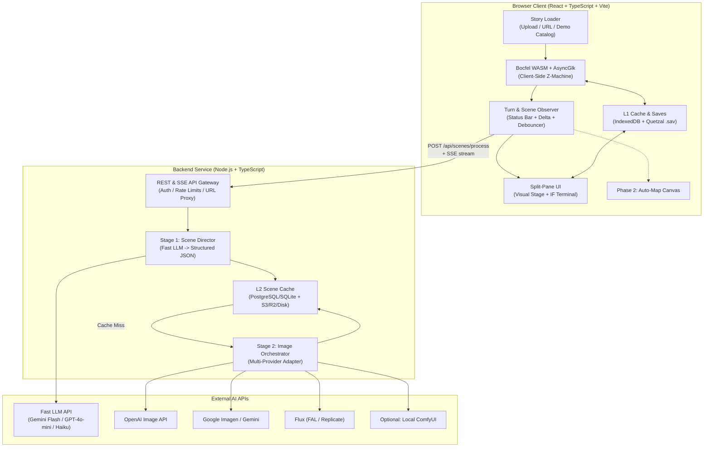

# Zorkaliser — Software Specification

**Version:** 1.0  
**Status:** Draft for Review  
**Scope:** Phase 1 (Browser Z-Machine Interpreter + Real-Time AI Scene Illustration) & Phase 2 (Interactive Auto-Mapping)

---

## 1. Executive Summary

**Zorkaliser** is a browser-based Z-machine interactive fiction (IF) player that brings classic Infocom and Inform text adventures to life with **real-time, AI-generated scene illustrations**. As the player explores a game, Zorkaliser intercepts the game's structured output stream, analyzes location entries and meaningful visual state changes, and renders cohesive artwork on the fly in a user-selected art style (e.g., *Photorealistic Cinema*, *80s Fantasy Oil Painting*, *Cartoon*, *Cyberpunk Noir*, *Pixel Art*).

### Core Design Principles
1. **Zero Wheel-Reinvention on Emulation:** Reuse battle-tested, MIT-licensed open-source Z-machine emulation (`Bocfel` compiled to WebAssembly via `Emglken`, paired with `AsyncGlk` from the `Parchment` ecosystem) rather than writing a new Z-machine VM from scratch.
2. **Never Block Gameplay:** Classic text play remains instantaneous. Image analysis and generation run asynchronously in the background with smooth visual crossfades, request debouncing, and graceful fallbacks on API errors.
3. **Visual Coherence Over Raw Prompts:** A fast LLM "Scene Director" stage translates terse 1980s text—and remembers prior room descriptions when games run in `BRIEF` mode—into rich, stylistically consistent image prompts.
4. **Aggressive Smart Caching:** Scenes are cached at both the browser and backend layers by story fingerprint, visual style, location, and visible state so revisiting rooms is instantaneous and API costs stay low.
5. **Phase 2 Ready:** The interpreter bridge and scene-analysis schema are designed upfront to support **Interactive Auto-Mapping** without architectural rewrites.

---

## 2. Open-Source Z-Machine Interpreter Strategy

### 2.1 Evaluation of Open-Source Options

| Project | Language / Runtime | Z-Machine Support | License | Fit for Zorkaliser |
| :--- | :--- | :--- | :--- | :--- |
| **Parchment / Emglken + Bocfel + AsyncGlk** (`curiousdannii/parchment`, `emglken`, `asyncglk`) | C -> WebAssembly (Bocfel) + TypeScript (AsyncGlk) | V1–V8 (full Infocom & Inform compliance, Unicode, undo, Quetzal autosave) | MIT | **Recommended Primary.** Modern browser standard; cleanly separates VM output from DOM via structured RemGlk JSON streams. |
| **ifvms.js / ZVM** (`curiousdannii/ifvms.js`) | Pure JavaScript | V3, V4, V5, V8 | MIT | Good lightweight fallback, but lacks V1/V2/V6/V7 and is largely superseded by Bocfel/Emglken in modern Parchment. |
| **JSZM** | Pure ES6 JavaScript | V3 (partial V4/V5) | MIT | Too limited for full Infocom catalog (e.g., Trinity, Bureaucracy, Beyond Zork, Shogun). |
| **ZMPP** | Java | V1–V8 | GPL / LGPL | JVM-based; not browser-native without heavy transpilation/server streaming. |

### 2.2 Integration Architecture (Wrap, Don't Rewrite)
Rather than forking an entire legacy UI, Zorkaliser will consume **`emglken` (Bocfel WASM)** and **`asyncglk`** as dependencies (with a thin, maintainable fork of `bocfel` only if Phase 2 opts into direct VM telemetry hooks):

```
Story File (.z1–.z8 / .zblorb)
        │
        ▼
Bocfel WASM (via Emglken)
        │  Emits structured RemGlk JSON updates
        ▼
Zorkaliser Glk Interceptor Bridge (TypeScript)
   ├──► React Terminal Renderer (AsyncGlk / custom GlkOte view)
   └──► Turn & Scene Observer (Status Line + Narrative Delta + Command)
```

**Why the RemGlk / AsyncGlk JSON boundary is ideal:**
- **Clean Window Separation:** Glk separates the **Grid Window** (top status bar containing room title, score, and move count) from the **Buffer Window** (main scrolling story prose). We never need fragile DOM scraping.
- **Native Quetzal Saves & Autosaves:** Bocfel + AsyncGlk natively support standard Quetzal (`.sav`) files and IndexedDB turn-based autosaves.
- **Optional Phase 2 Telemetry Hook:** A tiny (<30 line) optional C/Emscripten export in Bocfel can expose the Z-machine's internal `current_location_object_id` (global variable `0` / parent of the player object) alongside each turn. This cleanly solves identical room titles (e.g., Zork's *"Maze of twisty little passages, all alike"*).

---

## 3. System Architecture



### 3.1 Tech Stack
- **Frontend:** TypeScript, React 19, Vite, Tailwind CSS, Zustand (UI & session state), IndexedDB (`idb`) for local saves & L1 image cache, `emglken` + `asyncglk` for Z-machine execution.
- **Backend:** Node.js (LTS), TypeScript, Fastify (or Hono) with SSE support, Zod (strict schema validation), Drizzle ORM or Prisma.
- **Persistence & Storage:**
  - **Development / Self-Hosted:** SQLite + local filesystem asset storage.
  - **Production Hosted:** PostgreSQL + S3-compatible object storage (Cloudflare R2 / AWS S3 / GCS) served via CDN, optional Redis for rate limiting and job coordination.

---

## 4. Phase 1 Functional Specification

### 4.1 Game Loading & Session Setup
1. **Story Input Sources:**
   - **Local File Upload / Drag-and-Drop:** Supports `.z1`–`.z8`, `.dat`, and `.zblorb` story files (read entirely in the browser; story bytes are *not* uploaded to the server to respect copyright and reduce bandwidth).
   - **Load by URL:** Fetch public story files from IFDB / IF Archive via a hardened backend proxy (`POST /api/proxy/story`) with domain allowlisting/SSRF checks and a 10 MB size cap.
   - **Curated Free Demo Catalog:** A small list of legally redistributable, free/open-licensed Z-code games (e.g., classic IF Archive freeware demos) so first-time users can test Zorkaliser in one click. *(Commercial Infocom story files are never bundled or hosted.)*
2. **Story Fingerprinting:**
   - Upon loading a story file in the browser, compute a deterministic `storyId` using the Z-machine header metadata (Version, Release, Serial Number, Checksum) plus `SHA-256` of the file bytes (or Blorb IFID if present).
   - Only `storyId` and optional user-visible title are sent to the backend for caching—never the raw story binary.
3. **Visual Style Selection (Pre-Game & Mid-Game):**
   - Before starting (and changeable anytime from Settings), the player selects an **Art Style Preset**.
   - Each preset defines a structured **Style Bible** (medium, lighting, palette, composition rules, lens/brushwork, negative cues) injected into the image prompt to maintain visual continuity across the entire game.

   **Built-In Style Presets (Initial Set):**
   | Preset ID | Display Name | Art Direction Summary |
   | :--- | :--- | :--- |
   | `photoreal` | Photorealistic Cinema | 35mm anamorphic film still, natural volumetric lighting, realistic textures, atmospheric depth |
   | `fantasy-oil` | Classic 80s Fantasy Oil | Vintage paperback / Infocom box-art oil painting, rich chiaroscuro, painterly brushwork |
   | `cartoon` | Animated Graphic Novel | Clean ink linework, vibrant cel-shaded colors, expressive stylized environments |
   | `cyberpunk` | Cyberpunk Noir | Rain-slicked neon accents, high-contrast synth-noir lighting, futuristic re-imagining of locations |
   | `pixel-art` | 16-Bit Pixel Art | Crisp LucasArts / Sierra classic point-and-click adventure pixel art, dithered lighting |
   | `watercolor` | Storybook Watercolor | Hand-painted ink-and-wash watercolor on textured paper, warm atmospheric washes |
   | `gothic-ink` | Dark Gothic Engraving | Moody monochrome / sepia woodcut and pen-and-ink illustration with dramatic shadows |
   | `custom` | Custom Style | User-provided style description (sanitized and combined with base framing guidelines) |

4. **Generation Mode Preferences:**
   - **Dynamic (Default):** Generate on entering a new location *and* on significant visible state changes (lamp lit, door opened, item taken, creature defeated/appearing).
   - **Location Only:** Generate once per unique room + style (lowest cost; revisits always hit cache).
   - **Manual Only:** Only generate when the player clicks **Illustrate Current Scene**.

---

### 4.2 Turn Interception & Classic IF Edge-Case Handling

Interactive fiction has quirks that break naive "send last output to image API" approaches. Zorkaliser handles them explicitly in the **Turn & Scene Observer**:

1. **Extracting Turn Payloads:**
   On every Glk update cycle after a player command:
   - `statusLine`: Parsed text from Glk Grid Window(s) (extracts `roomTitle`, optional `score`, `moves`, or `time`).
   - `command`: The text command submitted by the player (e.g., `open mailbox`, `north`, `turn on lamp`).
   - `narrativeDelta`: Newly appended prose from the main Glk Buffer Window.
   - `turnIndex`: Monotonically increasing turn counter.

2. **Deterministic Fast-Path Short-Circuiting (Zero AI Cost):**
   Before calling any backend AI endpoint, the client applies fast heuristics to skip non-visual turns:
   - Meta-commands: `save`, `restore`, `restart`, `quit`, `score`, `version`, `verbose`, `brief`, `superbrief`, `script`, `unscript`, `undo`, `help`, `hints`, `wait` (when output is just "Time passes.").
   - Parser rejections / unchanged room errors: e.g., `"I don't know the word..."`, `"You can't go that way."`, `"You can't see any such thing."`, `"That's not a verb I recognize."` when `roomTitle` did not change.
   - Pure inventory checks (`i` / `inventory`) unless configured otherwise.

3. **Handling `BRIEF` Mode (Critical for Infocom Games):**
   - Classic Infocom games default to `BRIEF` mode: the first time you enter *Kitchen*, the game prints the full room description; the second time, it only prints `Kitchen` (plus any loose items).
   - **Solution:** Maintain a client-side `RoomMemory` store indexed by normalized room title (or VM room ID when available). On first visit (or after `LOOK`), store `baseDescription`. On subsequent turns in that room, send `{ roomTitle, baseDescription, latestTurnOutput, activeStateTags }` to Stage 1 so the prompt generator never loses architectural context.

4. **Handling Darkness ("Pitch Black"):**
   - Detect darkness cues (status line or prose such as *"It is pitch black"* / *"too dark to see"*).
   - Rather than hallucinating a lit room, Stage 1 emits `locationKey: "__darkness__"` and generates (or retrieves from cache) a single atmospheric pitch-black / faint-silhouette scene matching the selected style preset.

5. **Rapid Input Debouncing & Request Cancellation:**
   - Players often speed-walk through known rooms (`n`, `n`, `e`, `d`).
   - Wait **450 ms** after a turn settles before dispatching a generation request.
   - Maintain a monotonic `requestSeq` + `AbortController`: if a new turn arrives while an earlier scene is still generating, abort/ignore the stale UI update (or let it quietly populate the cache if already >80% done, without flashing the wrong room on screen).

---

### 4.3 Two-Stage AI Scene Pipeline

#### Stage 1: Scene Director (Fast LLM)
A low-latency, structured-output LLM (e.g., Gemini 2.5 Flash, GPT-4o-mini, or Claude Haiku—configurable via provider adapter) acts as the art director.

**Input Context:**
```typescript
interface SceneAnalysisRequest {
  sessionId: string;
  storyId: string;
  storyTitle?: string;
  stylePresetId: string;
  customStylePrompt?: string;
  reactivityMode: 'dynamic' | 'location_only';
  turn: {
    turnIndex: number;
    command: string;
    statusBarRoomTitle: string | null;
    narrativeDelta: string;
    vmLocationId?: number; // Optional Phase 2 telemetry
  };
  roomMemory: {
    previousLocationKey: string | null;
    knownBaseDescription: string | null;
    previousStateTags: string[];
    carriedLightSource?: string | null;
  };
}
```

**Structured JSON Output:**
```typescript
interface SceneDirectorOutput {
  shouldGenerate: boolean;
  changeType: 'new_location' | 'major_state_change' | 'darkness' | 'no_visual_change';
  locationKey: string;              // Canonical slug, e.g., "west_of_house"
  displayTitle: string;             // Clean room title, e.g., "West of House"
  updatedBaseDescription: string;   // Extracted/merged canonical room description for RoomMemory
  stateTags: string[];              // Sorted visual facts, e.g., ["door:boarded", "mailbox:open"]
  imagePrompt: string;              // First-person POV, concrete scene composition + Style Bible
  negativePrompt: string;           // "text, watermark, UI overlay, speech bubbles, modern HUD..."
  paletteHint?: string;             // Hex color accent for subtle UI ambiance
  // Phase 2 forward-compatible hook (optional in Phase 1)
  mapHints?: {
    movementDirection?: string | null;
    mentionedExits: string[];
    isOneWaySuspected?: boolean;
  };
}
```

**Prompt Engineering Rules for Stage 1:**
- Always frame scenes from an immersive **first-person environmental POV** (avoid depicting the unnamed player character's face unless the game explicitly establishes it).
- Explicitly forbid embedded text, HUD elements, captions, or labels in the generated image.
- Keep `stateTags` strictly visual and canonicalized (e.g., `lantern:lit`, `trapdoor:open`, `troll:present`) so cache hits stay high even when prose phrasing varies slightly.
- Translate classic fantasy combat / danger into atmospheric PG-13 dramatic framing to avoid unnecessary safety-filter false positives.

#### Stage 2: Multi-Provider Image Orchestrator
All image generation backends implement a uniform TypeScript adapter contract:

```typescript
export interface ImageGenerationRequest {
  prompt: string;
  negativePrompt?: string;
  aspectRatio: '16:9' | '4:3' | '1:1';
  quality: 'fast' | 'balanced' | 'high';
  seed?: number;
}

export interface ImageGenerationResult {
  imageBytes: Buffer;
  mimeType: 'image/webp' | 'image/png' | 'image/jpeg';
  width: number;
  height: number;
  provider: string;
  model: string;
  latencyMs: number;
  estimatedCostUsd?: number;
}

export interface ImageProviderAdapter {
  readonly id: string;
  isConfigured(): boolean;
  generate(req: ImageGenerationRequest, signal?: AbortSignal): Promise<ImageGenerationResult>;
}
```

**Planned Adapters:**
1. **`FluxAdapter` (FAL.ai / Replicate):** Recommended default for `fast` mode (Flux Schnell / Flux.1 Dev — ~1.5–3s latency, strong style adherence, low cost).
2. **`GoogleImagenAdapter` (Gemini / Imagen API):** High photorealism and painterly fidelity; native aspect ratio support.
3. **`OpenAIAdapter` (`gpt-image-1`):** Strong prompt comprehension for complex multi-object adventure rooms.
4. **`LocalComfyUIAdapter` (Optional):** Allows self-hosters to point Zorkaliser at a local GPU server.

**Provider Resilience:**
- Configurable primary + fallback provider chain (e.g., if Primary times out after 15s or hits a transient 429/5xx, automatically retry once on Fallback).
- If a safety filter blocks a prompt, retry once with a softened atmospheric prompt before returning a graceful non-blocking warning to the UI.

---

### 4.4 Caching Strategy

To keep revisits instantaneous and prevent runaway API bills:

1. **Deterministic Cache Key:**
   ```
   cacheKey = sha256(
     storyId + "|" +
     styleKey + "|" +          // presetId or sha256(customStylePrompt)
     locationKey + "|" +
     stateTags.sort().join(",") + "|" +
     aspectRatio + "|" +
     qualityTier + "|" +
     promptSchemaVersion
   )
   ```
2. **Two-Tier Cache Lookup:**
   - **L1 (Browser IndexedDB):** Checked immediately on `location_only` revisits or after receiving `cacheKey` from Stage 1. Instant 0 ms display.
   - **L2 (Backend Metadata DB + Object Storage):** Checked before invoking Stage 2. Images are stored in compressed **WebP** (~80–180 KB per 16:9 frame) and served via immutable cache-controlled URLs (`Cache-Control: public, max-age=31536000, immutable`).
   - **Shared vs. Private Cache:** Built-in style presets can share L2 cache entries across sessions/users for the same `storyId` + `locationKey` + `stateTags` (major cost reduction for popular classics like *Zork I*!). Custom style prompts are scoped to their prompt hash.
3. **Manual Regeneration:**
   - Clicking **Regenerate Scene** bypasses the cache lookup (increments a `variation` seed), generates a fresh image, and appends it to the room's variation switcher so the player can toggle between versions.

---

### 4.5 User Interface & UX Specification

#### Layout
- **Desktop (≥1024px):** Split-pane layout with a draggable vertical divider (default **55% Visual Stage** on left, **45% Interactive Fiction Terminal** on right; option to swap sides or collapse visuals to focus on reading).
- **Tablet / Mobile (<1024px):** Top collapsible artwork banner (16:9) above the terminal pane, auto-shrinking gently while the on-screen keyboard is open.

#### Visual Stage Pane
- **Crossfade Transition:** New scenes dissolve smoothly over the previous scene (400 ms CSS opacity crossfade) so there is never a jarring flash.
- **Non-Blocking Progress Pill:** Subtle corner pill displaying live SSE status (`Analyzing scene...` -> `Painting scene...`) with a cancel button.
- **Scene Overlay Controls (hover/tap):**
  - Current room title & active style badge (click to switch style mid-game).
  - **Regenerate** button + variation carousel (`1 / 2`) if regenerated.
  - **Scene Gallery** drawer showing thumbnails of all locations illustrated during the playthrough.
  - **Prompt Inspector** (collapsible) showing the Stage 1 prompt, state tags, provider, latency, and cache hit/miss badge.
  - **Fullscreen / Lightbox** viewer.

#### Interactive Fiction Terminal Pane
- **Pinned Status Header:** Cleanly renders the Glk status bar (Room Title, Score/Moves or Time).
- **Readable Transcript:** Classic book-grade typography with configurable font family (Serif / Sans / Retro Monospace), font size, line width, and color themes (*Parchment Light*, *Midnight Dark*, *Sepia*, *Amber/Green CRT*).
- **Enhanced Command Bar:**
  - Command input with `Up`/`Down` history navigation.
  - Optional quick-action chips (`Look`, `Inventory`, `Wait`, compact N/S/E/W/U/D compass pad for mobile/casual play).

#### Save & Session Management
- **Automatic Turn Autosave:** Saved to browser IndexedDB after every turn (including both Quetzal VM snapshot + `RoomMemory` + style selection + Phase 2 map graph).
- **Named Save Slots:** Save/restore multiple slots per game inside the browser UI, plus standard **Download / Upload `.sav` (Quetzal)** so saves remain portable with other Z-machine interpreters (Frotz, Gargoyle, Parchment).

---

### 4.6 Backend API Specification

| Method | Endpoint | Purpose |
| :--- | :--- | :--- |
| `GET` | `/api/health` | Service health & configured provider status |
| `GET` | `/api/styles` | List built-in style presets and available quality tiers |
| `GET` | `/api/catalog` | Curated list of legally redistributable free/demo Z-code stories |
| `POST` | `/api/proxy/story` | Safe proxy to fetch story files from allowlisted IF hosts (e.g., `ifarchive.org`) |
| `POST` | `/api/scenes/process` | Runs Stage 1 analysis -> checks L2 cache -> returns either `{ status: "skipped" }`, `{ status: "hit", imageUrl, ... }`, or `{ status: "generating", jobId, streamUrl }` |
| `GET` | `/api/scenes/jobs/:jobId/events` | Server-Sent Events (SSE) stream emitting `analyzing`, `generating`, `completed` (with `imageUrl`), or `failed` |
| `POST` | `/api/scenes/regenerate` | Forces a fresh image generation for a given scene state with a new seed |
| `GET` | `/api/assets/:assetId.webp` | Serves cached WebP assets (or 302 redirects to CDN/R2 signed URL) |

---

### 4.7 Database Schema (Core Tables)

```sql
-- Cached generated images (reusable across sessions for matching fingerprints)
CREATE TABLE cached_scenes (
  cache_key         TEXT PRIMARY KEY,
  story_id          TEXT NOT NULL,
  style_key         TEXT NOT NULL,
  location_key      TEXT NOT NULL,
  state_tags_json   TEXT NOT NULL,
  prompt_used       TEXT NOT NULL,
  provider          TEXT NOT NULL,
  model             TEXT NOT NULL,
  asset_url         TEXT NOT NULL,
  width             INTEGER NOT NULL,
  height            INTEGER NOT NULL,
  variation_index   INTEGER NOT NULL DEFAULT 0,
  hit_count         INTEGER NOT NULL DEFAULT 0,
  created_at        TIMESTAMP NOT NULL DEFAULT CURRENT_TIMESTAMP
);
CREATE INDEX idx_cached_scenes_lookup ON cached_scenes (story_id, style_key, location_key);

-- Usage, cost accounting, and rate-limit telemetry
CREATE TABLE generation_logs (
  id                TEXT PRIMARY KEY,
  session_id        TEXT NOT NULL,
  user_id           TEXT,
  story_id          TEXT NOT NULL,
  cache_hit         BOOLEAN NOT NULL,
  llm_provider      TEXT,
  llm_tokens_in     INTEGER,
  llm_tokens_out    INTEGER,
  image_provider    TEXT,
  latency_ms        INTEGER,
  estimated_cost    REAL,
  status            TEXT NOT NULL, -- 'ok' | 'filtered' | 'error'
  created_at        TIMESTAMP NOT NULL DEFAULT CURRENT_TIMESTAMP
);
```

---

## 5. Security, Legal, and Operational Requirements

1. **API Key Isolation:** All LLM and image-generation API keys live exclusively in backend environment variables—never exposed to browser bundles.
2. **Abuse & Cost Controls:**
   - Per-IP and per-session sliding-window rate limits (e.g., max 20 fresh image generations per 10 minutes, daily cap per anonymous session, configurable higher limits for authenticated users).
   - Hard monthly/daily budget circuit breaker on the backend so a traffic spike cannot generate runaway bills.
   - Optional lightweight auth (magic link / OAuth / guest session token) ready to plug into the gateway.
3. **Copyright Compliance:**
   - Never host, distribute, or cache copyrighted Infocom story files on the server.
   - Story execution occurs 100% client-side in WebAssembly.
   - `POST /api/proxy/story` validates target URLs against an explicit host allowlist (blocking RFC 1918 private IPs, localhost, and cloud metadata endpoints to prevent SSRF) and enforces strict MIME/magic-byte validation (`Z-machine` header byte `1..8` or `FORM....IFRS` Blorb header).
4. **XSS & Injection Safety:**
   - Escape all Z-machine text and room titles before DOM insertion.
   - Treat game prose and custom style inputs as untrusted data inside Stage 1 LLM prompts (structured delimiters + strict Zod output validation + prompt length caps).

---

## 6. Phase 2 Specification: Interactive Auto-Mapping

Phase 2 adds an interactive, spoiler-free **Auto-Map** that builds itself organically as the player explores the world.

### 6.1 Room & Edge Discovery (Hybrid Strategy)
Classic text adventures include non-Euclidean connections, one-way drops (e.g., chimneys/chutes), locked doors, teleportation, and identical-name mazes. Phase 2 combines two signals:

1. **Baseline (Command + Scene Director Graph Tracking — Works on All Games):**
   - Intercepts directional commands (`n/s/e/w/ne/nw/se/sw/u/d/in/out/enter <obj>`).
   - When the turn results in a `new_location`, creates (or links) a directed edge `previousNode --[direction]--> currentNode`.
   - Parses mentioned exits from `SceneDirectorOutput.mapHints.mentionedExits` to draw dashed **"Unexplored Exit" stubs** without spoiling where they lead.
   - Detects failed movements (`"The door is locked."`) to annotate edges as `blocked` / `locked`.
2. **High-Precision Upgrade (Optional Bocfel WASM Location ID Hook):**
   - Exposes the Z-machine's internal room object ID (`vmLocationId`) per turn.
   - Guarantees **100% disambiguation** of identically named rooms (e.g., *Maze*, *Forest*) and detects instant teleports even when no compass command was typed.

### 6.2 Map Data Model

```typescript
interface GameMapGraph {
  storyId: string;
  currentNodeId: string | null;
  nodes: Record<string, MapNode>;
  edges: Record<string, MapEdge>;
}

interface MapNode {
  id: string;                     // vmLocationId (if available) or locationKey
  title: string;
  level: number;                  // Floor/elevation index (0 = ground, +1 up, -1 down)
  position: { x: number; y: number };
  positionLocked: boolean;        // True if user manually dragged this room
  visited: boolean;
  isDark: boolean;
  thumbnailUrl?: string;          // Reuses Phase 1 AI artwork!
  unexploredExits: string[];      // Compass directions mentioned but not yet taken
  userNotes: string;              // Player annotations (e.g., "Need key for grating")
  notedItems: string[];           // Notable objects left or seen here
}

interface MapEdge {
  id: string;
  fromNodeId: string;
  toNodeId: string;
  direction: string;              // 'n' | 's' | 'e' | 'w' | 'ne' | 'nw' | 'se' | 'sw' | 'u' | 'd' | 'in' | 'out' | 'special'
  bidirectional: boolean;
  status: 'open' | 'locked' | 'one_way' | 'blocked';
  label?: string;                 // e.g., "iron grating", "chimney"
}
```

### 6.3 Auto-Map UI & Features
- **Layout Engine:** Compass-constrained force/grid layout (using React Flow or custom Canvas/SVG) that places `N` above, `E` right, `SE` down-right, etc., while resolving overlaps cleanly and separating `UP`/`DOWN` transitions into switchable **Elevation Layers** (with translucent ghosting of adjacent floors).
- **Visual Integration with Phase 1:** Each map node displays the room's title and a miniature thumbnail of its Phase 1 AI illustration. Clicking any node opens a popover with its full artwork, stored room description, and editable player notes.
- **Click-to-Walk (Optional Convenience):** Double-clicking a visited room computes the shortest known safe path (BFS over `open` edges) and offers to auto-execute the sequence of movement commands one turn at a time, halting immediately if interrupted by an unexpected event (e.g., thief encounter, locked door, or combat).
- **Manual Escape Hatches:** Players can drag nodes to tidy layouts, manually merge/split rooms (for tricky mazes if running without the VM hook), mark rooms with custom icons/colors, and export/import the map as JSON, SVG, or PNG.
- **Save Synchronization:** The map graph snapshots automatically alongside browser autosaves and restores cleanly when loading an earlier save (preventing map desync after dying or restoring).

---

## 7. Proposed Repository Structure

```text
zorkaliser/
├── SPEC.md
├── package.json                  # Workspace root (pnpm workspaces)
├── apps/
│   ├── web/                      # React + Vite + TypeScript frontend
│   │   ├── src/
│   │   │   ├── components/       # VisualStage, TerminalPane, StylePicker, SaveModal, MapCanvas (P2)
│   │   │   ├── engine/           # Emglken/Bocfel loader, AsyncGlk interceptor, TurnObserver
│   │   │   ├── store/            # Zustand stores (session, roomMemory, sceneCache, mapGraph)
│   │   │   └── services/         # API client, SSE subscriber, IndexedDB persistence
│   └── api/                      # Node.js + Fastify/Hono TypeScript backend
│       ├── src/
│       │   ├── routes/           # /scenes, /styles, /catalog, /proxy
│       │   ├── director/         # Stage 1 LLM Scene Director + prompt templates + Style Bibles
│       │   ├── providers/        # ImageProviderAdapter implementations (Flux, Google, OpenAI, ComfyUI)
│       │   ├── cache/            # DB metadata + S3/R2/Local asset storage
│       │   └── middleware/       # Rate limiting, SSRF guard, budget circuit breaker
├── packages/
│   └── shared/                   # Shared Zod schemas, TypeScript DTOs, style preset metadata
└── docker-compose.yml            # Local dev / self-hosted stack (API + Web + Postgres/SQLite)
```

---

## 8. Phased Implementation Roadmap

### Phase 1 — Real-Time Illustrated Z-Machine Player
- **Milestone 1.1: Core Z-Machine Shell**
  - Scaffold monorepo (`apps/web`, `apps/api`, `packages/shared`).
  - Integrate `Bocfel` (`emglken`) + `AsyncGlk` in React; verify loading local `.z3`/`.z5`/`.z8`/`.zblorb` files, status bar separation, command history, IndexedDB autosave, and Quetzal `.sav` import/export.
- **Milestone 1.2: Turn Observer & Scene Director (Stage 1)**
  - Implement Glk update interception, deterministic meta-command filtering, `BRIEF`-mode `RoomMemory`, and darkness detection.
  - Build backend Stage 1 Scene Director with structured Zod output and the 7 built-in Style Bibles.
- **Milestone 1.3: Image Generation, Caching & Live UI (Stage 2)**
  - Implement `ImageProviderAdapter` starting with `FluxAdapter` (fast default) + `OpenAIAdapter` + `GoogleImagenAdapter`.
  - Add SSE progress streaming, L1 IndexedDB + L2 backend WebP cache, request debouncing/cancellation, and split-pane Visual Stage with crossfades, regeneration, and scene gallery.
- **Milestone 1.4: Hardening & Deployment**
  - Add SSRF-safe URL story proxy, curated free demo catalog, rate limiting, cost circuit breaker, mobile responsiveness, and Docker deployment config.

### Phase 2 — Interactive Auto-Mapping
- **Milestone 2.1: Graph Engine & Movement Tracking**
  - Build movement parser + `mapHints` ingestion + `GameMapGraph` store synced with browser saves.
  - *(Optional)* Add Bocfel WASM `vmLocationId` hook for maze disambiguation.
- **Milestone 2.2: Auto-Map Canvas UI**
  - Build interactive compass-aligned pan/zoom canvas with floor layers, Phase 1 artwork thumbnails, unexplored exit stubs, manual drag/notes, and JSON/PNG export.
- **Milestone 2.3: Click-to-Walk**
  - Add BFS pathfinder with safe turn-by-turn execution and automatic interruption on unexpected game events.

---

## 9. Verification & Testing Strategy

1. **Z-Machine Emulation Compliance:**
   - Run the open-source **CZECH** (Comprehensive Z-machine Emulation CHecker) and **Praxix** test suites against the integrated Bocfel WASM runtime.
   - Verify real gameplay across Z-machine versions: V3 (*Zork I*), V4 (*Trinity* / *A Mind Forever Voyaging*), V5 (*Curses* / *Lost Pig*), and V8.
2. **Scene Director Golden Tests:**
   - Create a recorded transcript fixture suite (covering `BRIEF` revisits, pitch-black rooms, failed commands, lamp lighting, opening containers, and room transitions) and assert expected `shouldGenerate`, `locationKey`, and canonical `stateTags`.
3. **Cache & Concurrency Tests:**
   - Verify rapid speed-walking (`n`, `e`, `s`, `w` within 1s) triggers only 1 final image request.
   - Verify revisiting a previously rendered room + state yields an L1/L2 cache hit with 0 external image API calls.
4. **Resilience & Security Tests:**
   - Simulate AI provider timeouts, 429s, and safety-filter rejections; confirm the Z-machine game remains 100% playable without interruption.
   - Fuzz-test `/api/proxy/story` against SSRF targets (`127.0.0.1`, `169.254.169.254`, non-Z-machine binaries, oversized payloads).
